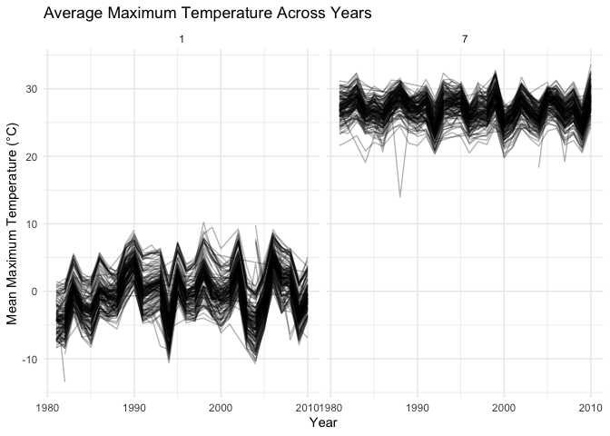
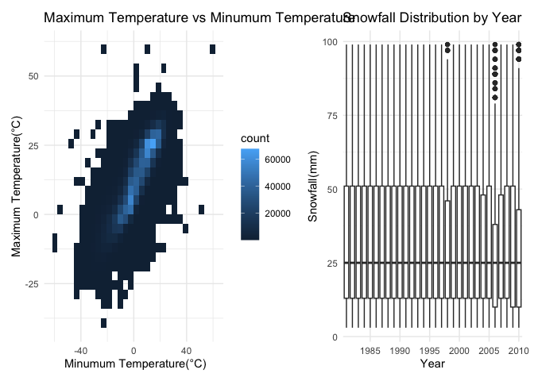

P8105 Homework 3
================
Tianqing Wang

``` r
library(tidyverse)
```

    ## ── Attaching core tidyverse packages ──────────────────────── tidyverse 2.0.0 ──
    ## ✔ dplyr     1.2.1     ✔ readr     2.2.0
    ## ✔ forcats   1.0.1     ✔ stringr   1.6.0
    ## ✔ ggplot2   4.0.3     ✔ tibble    3.3.1
    ## ✔ lubridate 1.9.5     ✔ tidyr     1.3.2
    ## ✔ purrr     1.2.2     
    ## ── Conflicts ────────────────────────────────────────── tidyverse_conflicts() ──
    ## ✖ dplyr::filter() masks stats::filter()
    ## ✖ dplyr::lag()    masks stats::lag()
    ## ℹ Use the conflicted package (<http://conflicted.r-lib.org/>) to force all conflicts to become errors

``` r
library(p8105.datasets)
```

# Problem 1 NY NOAA Weather Data

The goal is to do some exploration of this dataset. To that end, write a
short description of the dataset, noting the size and structure of the
data, describing some key variables, and indicating the extent to which
missing data is an issue. Then, do or answer the following (commenting
on the results of each):

• Do some data cleaning. Create separate variables for year, month, and
day. Ensure observations for temperature, precipitation, and snowfall
are given in reasonable units. For snowfall, what are the most commonly
observed values? Why?

• Make a two-panel plot showing the average max temperature in January
and in July in each station across years. Is there any observable /
interpretable structure? Any outliers?

• Make a two-panel plot showing (i) tmax vs tmin for the full dataset
(note that a scatterplot may not be the best option); and (ii) make a
plot showing the distribution of snowfall values greater than 0 and less
than 100 separately by year.

## Import and describe the dataset

``` r
library(p8105.datasets)
data("ny_noaa")
names(ny_noaa)
```

    ## [1] "id"   "date" "prcp" "snow" "snwd" "tmax" "tmin"

``` r
dim(ny_noaa)
```

    ## [1] 2595176       7

``` r
str(ny_noaa)
```

    ## tibble [2,595,176 × 7] (S3: tbl_df/tbl/data.frame)
    ##  $ id  : chr [1:2595176] "US1NYAB0001" "US1NYAB0001" "US1NYAB0001" "US1NYAB0001" ...
    ##  $ date: Date[1:2595176], format: "2007-11-01" "2007-11-02" ...
    ##  $ prcp: int [1:2595176] NA NA NA NA NA NA NA NA NA NA ...
    ##  $ snow: int [1:2595176] NA NA NA NA NA NA NA NA NA NA ...
    ##  $ snwd: int [1:2595176] NA NA NA NA NA NA NA NA NA NA ...
    ##  $ tmax: chr [1:2595176] NA NA NA NA ...
    ##  $ tmin: chr [1:2595176] NA NA NA NA ...
    ##  - attr(*, "spec")=
    ##   .. cols(
    ##   ..   id = col_character(),
    ##   ..   date = col_date(format = ""),
    ##   ..   prcp = col_integer(),
    ##   ..   snow = col_integer(),
    ##   ..   snwd = col_integer(),
    ##   ..   tmax = col_character(),
    ##   ..   tmin = col_character()
    ##   .. )

``` r
head(ny_noaa,50)
```

    ## # A tibble: 50 × 7
    ##    id          date        prcp  snow  snwd tmax  tmin 
    ##    <chr>       <date>     <int> <int> <int> <chr> <chr>
    ##  1 US1NYAB0001 2007-11-01    NA    NA    NA <NA>  <NA> 
    ##  2 US1NYAB0001 2007-11-02    NA    NA    NA <NA>  <NA> 
    ##  3 US1NYAB0001 2007-11-03    NA    NA    NA <NA>  <NA> 
    ##  4 US1NYAB0001 2007-11-04    NA    NA    NA <NA>  <NA> 
    ##  5 US1NYAB0001 2007-11-05    NA    NA    NA <NA>  <NA> 
    ##  6 US1NYAB0001 2007-11-06    NA    NA    NA <NA>  <NA> 
    ##  7 US1NYAB0001 2007-11-07    NA    NA    NA <NA>  <NA> 
    ##  8 US1NYAB0001 2007-11-08    NA    NA    NA <NA>  <NA> 
    ##  9 US1NYAB0001 2007-11-09    NA    NA    NA <NA>  <NA> 
    ## 10 US1NYAB0001 2007-11-10    NA    NA    NA <NA>  <NA> 
    ## # ℹ 40 more rows

``` r
ny_noaa|>
summarize(
  missing_snow=sum(is.na(snow)),
  missing_prcp=sum(is.na(prcp)),
  missing_snwd=sum(is.na(snwd)),
  missing_tmax=sum(is.na(tmax)),
  missing_tmin=sum(is.na(tmin))
)
```

    ## # A tibble: 1 × 5
    ##   missing_snow missing_prcp missing_snwd missing_tmax missing_tmin
    ##          <int>        <int>        <int>        <int>        <int>
    ## 1       381221       145838       591786      1134358      1134420

Description: This dataset has 7 variables and 2,595,176 observations.
Each observation represents a weather record from a specific weather
station on a particular date.

In these variables, ” Weather station ID(id), maximum temperature(tmax),
minimum temperature(tmin)” are character variables, “(date)” is a date
variable, “precipitation(prcp), snowfall(snow), snow depth(snwd)” are
integer variables.

In all these observations, “snow” has 381,221 missing values, “prcp” has
145,838 missing values, “snwd” has 591,786 missing values, “tmax” has
1,134,358 missing values, “tmin” has 1,134,420 missing values.

## Create separate variables for year, month, and day

``` r
ny_noaa = ny_noaa |>
  mutate(
    year = lubridate::year(date),
    month = lubridate::month(date),
    day = lubridate::day(date)
  )
names(ny_noaa)
```

    ##  [1] "id"    "date"  "prcp"  "snow"  "snwd"  "tmax"  "tmin"  "year"  "month"
    ## [10] "day"

``` r
dim(ny_noaa)
```

    ## [1] 2595176      10

``` r
head(ny_noaa,50)
```

    ## # A tibble: 50 × 10
    ##    id          date        prcp  snow  snwd tmax  tmin   year month   day
    ##    <chr>       <date>     <int> <int> <int> <chr> <chr> <dbl> <dbl> <int>
    ##  1 US1NYAB0001 2007-11-01    NA    NA    NA <NA>  <NA>   2007    11     1
    ##  2 US1NYAB0001 2007-11-02    NA    NA    NA <NA>  <NA>   2007    11     2
    ##  3 US1NYAB0001 2007-11-03    NA    NA    NA <NA>  <NA>   2007    11     3
    ##  4 US1NYAB0001 2007-11-04    NA    NA    NA <NA>  <NA>   2007    11     4
    ##  5 US1NYAB0001 2007-11-05    NA    NA    NA <NA>  <NA>   2007    11     5
    ##  6 US1NYAB0001 2007-11-06    NA    NA    NA <NA>  <NA>   2007    11     6
    ##  7 US1NYAB0001 2007-11-07    NA    NA    NA <NA>  <NA>   2007    11     7
    ##  8 US1NYAB0001 2007-11-08    NA    NA    NA <NA>  <NA>   2007    11     8
    ##  9 US1NYAB0001 2007-11-09    NA    NA    NA <NA>  <NA>   2007    11     9
    ## 10 US1NYAB0001 2007-11-10    NA    NA    NA <NA>  <NA>   2007    11    10
    ## # ℹ 40 more rows

## Ensure observations for temperature, precipitation, and snowfall are given in reasonable units.

``` r
ny_noaa = ny_noaa |>
  mutate(
    tmax = as.numeric(tmax) / 10,
    tmin = as.numeric(tmin) / 10,
    prcp = prcp / 10
  )
str(ny_noaa)
```

    ## tibble [2,595,176 × 10] (S3: tbl_df/tbl/data.frame)
    ##  $ id   : chr [1:2595176] "US1NYAB0001" "US1NYAB0001" "US1NYAB0001" "US1NYAB0001" ...
    ##  $ date : Date[1:2595176], format: "2007-11-01" "2007-11-02" ...
    ##  $ prcp : num [1:2595176] NA NA NA NA NA NA NA NA NA NA ...
    ##  $ snow : int [1:2595176] NA NA NA NA NA NA NA NA NA NA ...
    ##  $ snwd : int [1:2595176] NA NA NA NA NA NA NA NA NA NA ...
    ##  $ tmax : num [1:2595176] NA NA NA NA NA NA NA NA NA NA ...
    ##  $ tmin : num [1:2595176] NA NA NA NA NA NA NA NA NA NA ...
    ##  $ year : num [1:2595176] 2007 2007 2007 2007 2007 ...
    ##  $ month: num [1:2595176] 11 11 11 11 11 11 11 11 11 11 ...
    ##  $ day  : int [1:2595176] 1 2 3 4 5 6 7 8 9 10 ...
    ##  - attr(*, "spec")=
    ##   .. cols(
    ##   ..   id = col_character(),
    ##   ..   date = col_date(format = ""),
    ##   ..   prcp = col_integer(),
    ##   ..   snow = col_integer(),
    ##   ..   snwd = col_integer(),
    ##   ..   tmax = col_character(),
    ##   ..   tmin = col_character()
    ##   .. )

``` r
tail(ny_noaa,100)
```

    ## # A tibble: 100 × 10
    ##    id          date        prcp  snow  snwd  tmax  tmin  year month   day
    ##    <chr>       <date>     <dbl> <int> <int> <dbl> <dbl> <dbl> <dbl> <int>
    ##  1 USW00094794 2006-10-24   5.6    NA    NA   4.4   1.1  2006    10    24
    ##  2 USW00094794 2006-10-25   1.5    NA    NA   6.7   2.8  2006    10    25
    ##  3 USW00094794 2006-10-26   0.3    NA    NA   6.1   1.7  2006    10    26
    ##  4 USW00094794 2006-10-27   5.1    NA    NA  10    -3.3  2006    10    27
    ##  5 USW00094794 2006-10-28  25.9    NA    NA  10     3.9  2006    10    28
    ##  6 USW00094794 2006-10-29   0.5    NA    NA   7.8   3.3  2006    10    29
    ##  7 USW00094794 2006-10-30   0      NA    NA  12.2   2.2  2006    10    30
    ##  8 USW00094794 2006-10-31   1.3    NA    NA  20     3.3  2006    10    31
    ##  9 USW00094794 2006-11-01   0      NA    NA  12.2   3.3  2006    11     1
    ## 10 USW00094794 2006-11-02   0.3    NA    NA   6.7  -1.1  2006    11     2
    ## # ℹ 90 more rows

## For snowfall, what are the most commonly observed values? Why?

``` r
ny_noaa |>
  filter(!is.na(snow))|>
  count(snow, sort= TRUE) |>
  head(n=10)
```

    ## # A tibble: 10 × 2
    ##     snow       n
    ##    <int>   <int>
    ##  1     0 2008508
    ##  2    25   31022
    ##  3    13   23095
    ##  4    51   18274
    ##  5    76   10173
    ##  6     8    9962
    ##  7     5    9748
    ##  8    38    9197
    ##  9     3    8790
    ## 10   102    6552

The most commonly observed snowfall value was 0 mm, with 2,008,508
observations, because most days had no snowfall. Other common values
included 25 mm, 13 mm, 51 mm, and 76 mm. These values correspond to
common snowfall measurements in inches(25 mm=1 inch), which may reflect
conversion from inches to millimeters in dataset description.

## Make a two-panel plot showing the average max temperature in January and in July in each station across years. Is there any observable / interpretable structure? Any outliers?

``` r
ny_noaa |>
  filter (month %in% c(1,7),!is.na(tmax)) |>
  group_by(id, year, month) |>
  summarize(
    mean_tmax = mean(tmax)
    ) |>
ggplot(aes(x=year, y=mean_tmax, group=id)) +
  geom_line(alpha=0.3) +
  facet_grid(.~month) +
  labs(
    title = "Average Maximum Temperature Across Years",
    x= "Year",
    y= "Mean Maximum Temperature (°C)"
  ) +
    theme_minimal()
```

    ## `summarise()` has regrouped the output.
    ## ℹ Summaries were computed grouped by id, year, and month.
    ## ℹ Output is grouped by id and year.
    ## ℹ Use `summarise(.groups = "drop_last")` to silence this message.
    ## ℹ Use `summarise(.by = c(id, year, month))` for per-operation grouping
    ##   (`?dplyr::dplyr_by`) instead.

<!-- --> The
two-panel plot shows that average maximum temperatures in July are
substantially higher than those in January across weather stations. Both
months show considerable year-to-year variation, with no clear
consistent long-term trend. Most weather stations follow similar
temperature patterns, although some variation exists between stations.

A potential outlier is observed in July around 1988, where one station
has an unusually low average maximum temperature of approximately 14°C.
Some unusually low temperatures are also observed in January. These
observations may represent outliers, but further examination would be
needed to determine whether they are genuine measurements or data
errors.

## Make a two-panel plot showing (i) tmax vs tmin for the full dataset (note that a scatterplot may not be the best option); and (ii) make a plot showing the distribution of snowfall values greater than 0 and less than 100 separately by year.

``` r
temp_plot = ny_noaa |>
  filter(!is.na(tmax),!is.na(tmin)) |>
  ggplot(aes(x=tmin,y=tmax)) +
  geom_bin2d() +
  labs(
    title = "Maximum Temperature vs Minumum Temperature",
    x = " Minumum Temperature(°C)",
    y = "Maximum Temperature(°C)"
  )+
    theme_minimal()
```

``` r
snow_plot = ny_noaa |>
  filter(snow>0,snow<100) |>
  ggplot(aes(x=factor(year),y=snow)) +
  geom_boxplot() +
  labs(
    title = "Snowfall Distribution by Year",
    x = "Year",
    y = "Snowfall(mm)"
  )+
    theme_minimal() +
scale_x_discrete(
  breaks = c("1985", "1990", "1995",
             "2000", "2005", "2010")
)
```

``` r
library(patchwork)
temp_plot + snow_plot
```

    ## `stat_bin2d()` using `bins = 30`. Pick better value `binwidth`.

<!-- -->
The first plot shows a positive relationship between minimum and maximum
temperatures. Most observations are concentrated along an upward trend,
although there are some possible outliers.

The second plot shows that snowfall distributions are similar across
most years, with a median of around 25 mm. A few years have slightly
different distributions and some possible outliers.

# Problem 2 Accelerometer Data

# Problem 3 Citi Bike Data
